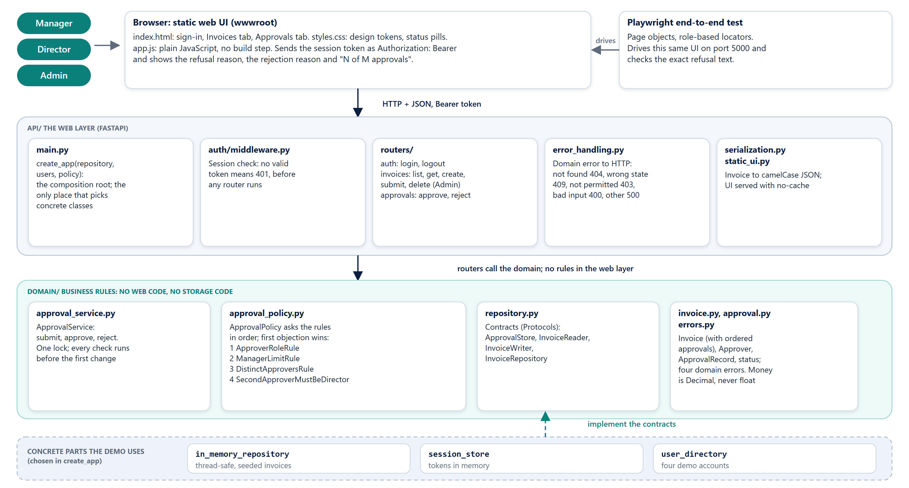

# Architecture and Design

## 1. Layers

```text
Browser (static UI: index.html, app.js, styles.css)
        |  HTTP + JSON, Bearer token
        v
api/main.py ---- composition root: chooses the implementations and wires them (create_app)
api/error_handling.py, api/auth/middleware.py ---- domain error to HTTP status; session check (401)
api/routers/ --- auth, invoices, approvals   (HTTP in, domain call, JSON out; no rules)
        |
        v
domain/ -------- ApprovalService (lifecycle, lock), approval_policy (pure rules),
                 Invoice, Approver, ApprovalRecord, errors, repository Protocol
        |
        v
api/in_memory_repository.py  (implements the repository Protocol, seeded data)
```



More diagrams (one request end to end, the rules as a decision flow, the lifecycle, the test layers) are in guide 21, Architecture Diagrams.

The dependency direction is one way: `api` imports `domain`, never the reverse. The domain has no web or storage code, which is what lets the mutation run cover it with fast unit tests.

## 2. Modules

| Module | Responsibility |
| --- | --- |
| `domain/approval_policy.py` | Four small rule classes (`ApproverRoleRule`, `ManagerLimitRule`, `DistinctApproversRule`, `SecondApproverMustBeDirectorRule`), an `ApprovalPolicy` that asks them in order, `ApprovalLimits` as data, and the convenience functions `rejection_reason`, `required_approvals`, `is_same_user` |
| `domain/approval_service.py` | `submit`, `approve`, `reject`. Finds the invoice, checks state, asks the policy, then mutates and saves, all under one lock |
| `domain/approval.py` | Frozen dataclasses `Approver` (blank username is invalid) and `ApprovalRecord` |
| `domain/invoice.py` | `Invoice` with an ordered `approvals` list |
| `domain/errors.py` | `InvoiceNotFoundError`, `InvalidStateError`, `ApprovalNotPermittedError`, `DomainValidationError` |
| `domain/repository.py` | Narrow storage contracts: `ApprovalStore` (what the approval service needs), `InvoiceReader`, `InvoiceWriter`, and the full `InvoiceRepository` |
| `api/main.py` | Composition root: `create_app(repository, users, policy)` builds the app from replaceable parts |
| `api/error_handling.py` | `ERROR_STATUS`, validation messages and the handlers that turn failures into responses |
| `api/auth/middleware.py` | The session check that returns 401 |
| `api/auth/user_directory.py` | `UserDirectory` contract and the demo implementation used by the login endpoint |
| `api/routers/*.py` | One router per resource; request bodies are pydantic models |
| `api/auth/*` | Demo users, in-memory session store, `require_role` dependency |
| `api/serialization.py` | Invoice to camelCase JSON, including `requiredApprovals` and `approvals` |
| `api/in_memory_repository.py` | Thread-safe in-memory store seeded with demo invoices |

## 3. Data model

```text
Invoice
  id, customer_name, amount (Decimal), status, created_at
  decided_by, decided_at, decision_note
  approvals: list[ApprovalRecord]     # ordered, oldest first

ApprovalRecord (frozen)  username, role, approved_at (UTC)
Approver (frozen)        username (non-blank), role
```

Status values: `Draft`, `PendingApproval`, `Approved`, `Rejected`.

```text
Draft --submit--> PendingApproval --approve (approvals < required)--> PendingApproval
                                   --approve (approvals == required)--> Approved
                                   --reject(reason)--> Rejected
```

A refused approval is not a transition: nothing changes.

## 4. The approve sequence

1. Acquire the service lock.
2. Load the invoice (`InvoiceNotFoundError` if missing).
3. Ensure the status is Pending Approval (`InvalidStateError` otherwise).
4. Ask `approval_policy.rejection_reason(...)`. If it returns a reason, raise `ApprovalNotPermittedError(reason)`. **Nothing has been mutated yet.**
5. Build a new approvals list with the new record and assign it.
6. If the count has reached `required_approvals(amount)`, set status Approved, `decided_by`, `decided_at`.
7. Save through the repository and return the invoice.

The router turns the exception into HTTP 403 `{"error": reason}`.

## 5. Key design decisions

| Decision | Choice | Why |
| --- | --- | --- |
| Money | `Decimal` | Exact comparison at 50,000.00 / 50,000.01 |
| Rules location | Pure function in the domain | Unit-testable and mutation-testable without a repository |
| Refusal signal | `ApprovalNotPermittedError` mapped to 403 | Distinct from 409 (wrong state) and 400 (bad input) |
| No partial writes | Check first, then mutate | The in-memory repository returns the live object, so mutating before checking would leak state |
| Atomicity | One `threading.Lock` in `ApprovalService` | Two simultaneous approvals by one user would otherwise both pass the duplicate check (review finding F1). A database repository would use a row lock or optimistic version |
| Same user | `strip().casefold()` | Stops `Dir.One` versus ` dir.one ` bypass |
| Approvals list | Replaced, not appended in place | A new list is assigned only after all checks pass |
| Error mapping | Central `ERROR_STATUS` in `api/error_handling.py` | Domain stays free of HTTP |
| Rules as classes | One class per rule, listed in `standard_policy()` | A new rule is a new class, not an edit to an existing one (see the SOLID guide, document 19) |
| Injected collaborators | Policy, clock, store, user directory passed in; defaults for the demo | Tests and other deployments swap them without touching the code that uses them |
| Input validation | pydantic `Field(gt=0, max_digits=14, decimal_places=2)` | Rejects `1e999999`, NaN, sub-cent values (review findings F2, F3) |
| Unexpected errors | Return 500 with no detail | Only `DomainValidationError` maps to 400 (review finding F5) |

## 6. Cross-cutting behaviour

- **Authentication:** every `/api` path except login needs `Authorization: Bearer <token>`; the middleware returns 401 otherwise.
- **Authorization:** `require_role(...)` at the router (approval endpoints allow Manager, Director and Admin; delete is Admin only). The domain is the single authority on who may actually approve.
- **Concurrency:** the lock covers submit, approve and reject; the repository has its own lock for list access.
- **Time:** timestamps are timezone-aware UTC.

## 7. Testing architecture

| Layer | Tool | Scope |
| --- | --- | --- |
| Policy | pytest | Pure function, every rule and boundary |
| Service | pytest + `FakeInvoiceRepository` | Lifecycle, persistence, unchanged-on-refusal, concurrency |
| API | pytest + FastAPI test client | Status codes, JSON shape, auth, validation |
| UI | Playwright (page objects) | One refused over-limit approval |
| Mutation | mutmut on `domain/` | Quality of the unit tests |

The fake repository records every `update()` and deep-copies what it stores, and raises on unknown ids, so "forgot to save" and "saved a refused attempt" both fail tests.

## 8. Repository layout

```text
backend/src/invoice_app/{domain,api}   backend/tests
e2e/{pages,tests}                      specs/ and .specify/ (Spec Kit)
docs/ (guides, mutation, pr-review)    scripts/ (mutation helpers, doc build)
.claude/{agents,skills,hooks}          logs/ai-interactions.jsonl
```
