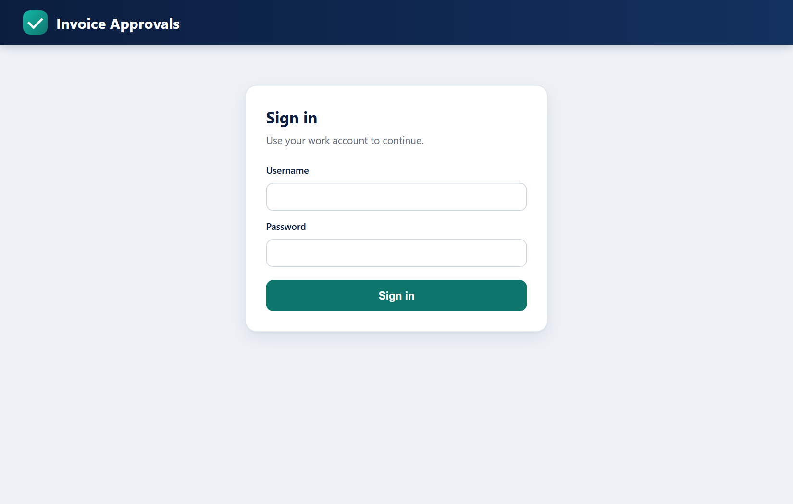
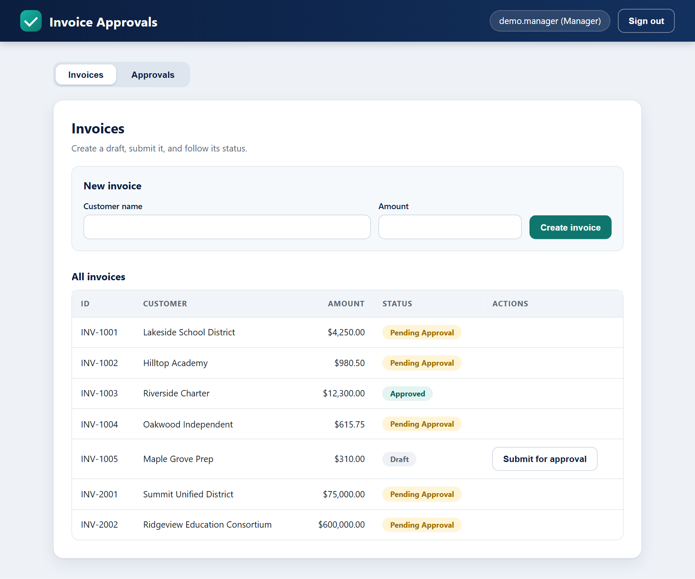
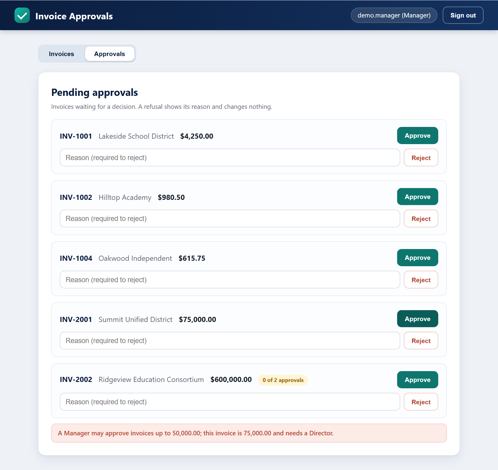
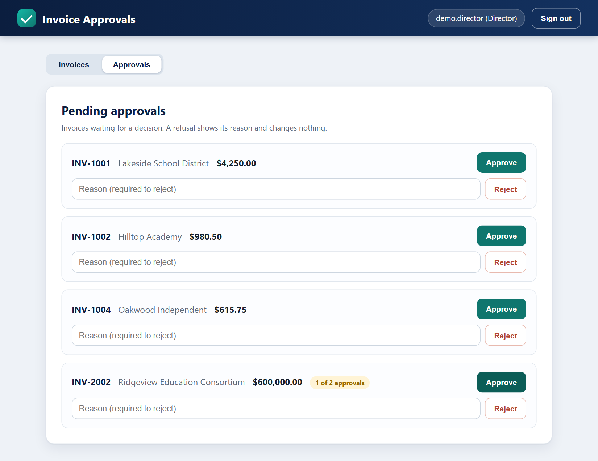
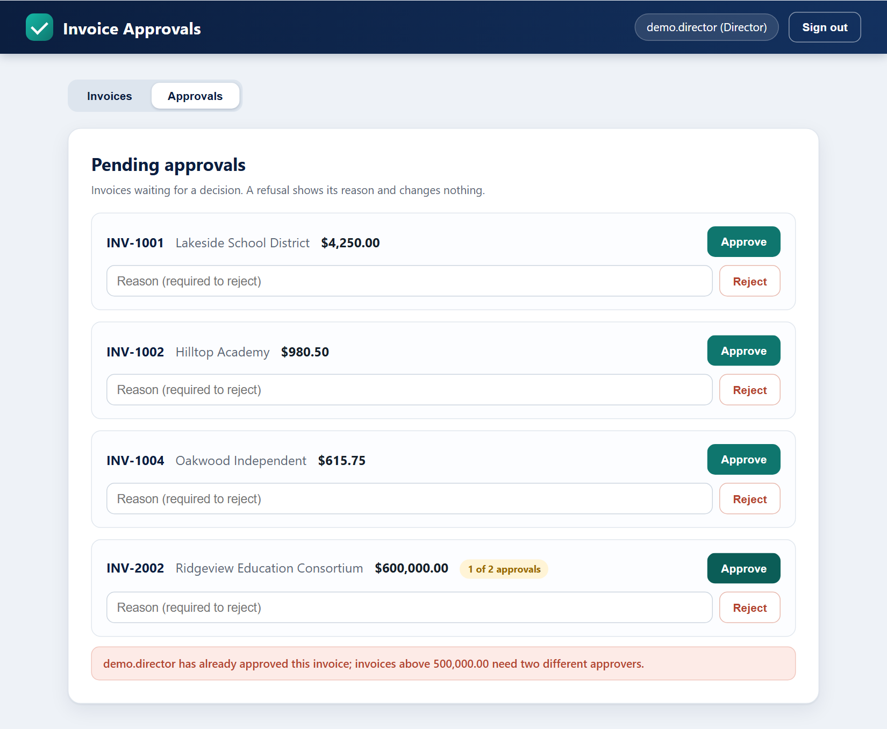
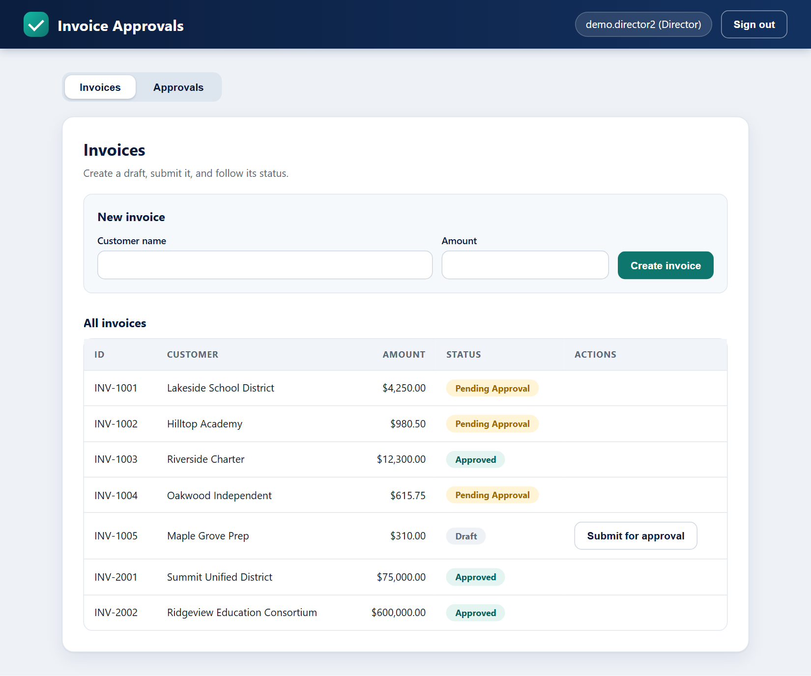

# User Guide

This guide is for the people who create and approve invoices in the web UI.

## 1. Starting the app

```text
pip install -e "backend[dev]"
python -m uvicorn invoice_app.api.main:app --app-dir backend/src --port 5000
```

Open <http://localhost:5000>. Data lives in memory: restarting the server resets everything to the demo data.

## 2. Signing in



Use one of the demo accounts (password `ChangeMe123!` for all):

| Username | Role | What the role can do |
| --- | --- | --- |
| `demo.manager` | Manager | Approve up to 50,000.00; give the first approval above 500,000.00 |
| `demo.director` | Director | Approve up to 500,000.00 alone; give either approval above that |
| `demo.director2` | Director | Same as above; a second, different Director |
| `demo.admin` | Admin | Reject and delete invoices; **cannot approve** |

## 3. The Invoices tab



The table lists every invoice with its customer, amount, status and actions. Use **New invoice** to add one (it starts as a Draft) and **Submit** to send a draft for approval. Statuses are Draft, Pending Approval, Approved and Rejected.

## 4. Approving an invoice

Open the **Approvals** tab to see everything waiting for a decision. Each entry has an **Approve** button and a **Reject** button with a reason field.

### 4.1 Who may approve what

| Invoice amount | Who may approve | Approvals needed |
| --- | --- | --- |
| up to 50,000.00 | Manager or Director | 1 |
| 50,000.01 to 500,000.00 | Director | 1 |
| above 500,000.00 | first: Manager or Director; second: Director | 2 different people |

### 4.2 When you are refused

If you press Approve and the rules do not allow it, a red message tells you why and **the invoice is left exactly as it was**. For example, a Manager on the 75,000.00 invoice (INV-2001):



The same applies if you are the wrong role, or you try to approve twice.

### 4.3 Invoices that need two approvals

An invoice above 500,000.00 (the demo has INV-2002 at 600,000.00) stays pending after the first approval and shows **1 of 2 approvals**:



The same person cannot give the second approval, even if their name is typed with different capitals or spaces:



A different Director completes it, and the invoice becomes Approved:



## 5. Rejecting an invoice

Type a reason in the field next to **Reject** and press the button. A reason is required. Rejecting works on any pending invoice, including one that already has its first approval.

## 6. Try it yourself: a 3-minute walkthrough

1. Sign in as `demo.manager`, open Approvals, press Approve on INV-2001 (75,000.00). Read the refusal; the invoice stays pending.
2. Sign out, sign in as `demo.director`, approve INV-2001. It becomes Approved.
3. Still as `demo.director`, approve INV-2002 (600,000.00). It shows 1 of 2 approvals.
4. Press Approve on INV-2002 again. You are refused: you already approved it.
5. Sign out, sign in as `demo.director2`, approve INV-2002. It becomes Approved.

## 7. Frequently asked questions

**Why can an Admin not approve?** Admin is an administrative role (reject, delete). Approval authority belongs to Managers and Directors only.

**Is 50,000.00 exactly allowed for a Manager?** Yes. The limits are inclusive: 50,000.00 is allowed, 50,000.01 is not.

**Does a refused attempt leave a trace?** No. Nothing about the invoice changes: not the status, the approver, the time or the list of approvals.

**I approved the first half and changed my mind.** Any pending invoice can still be rejected with a reason.
