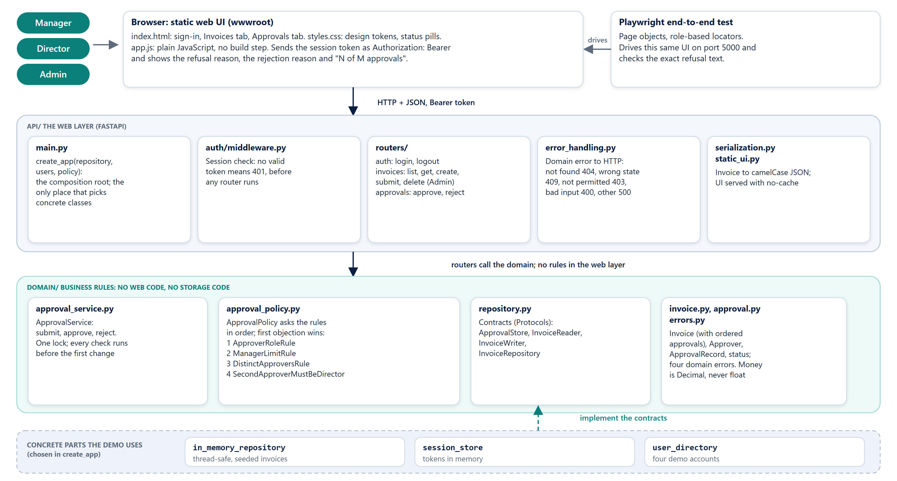
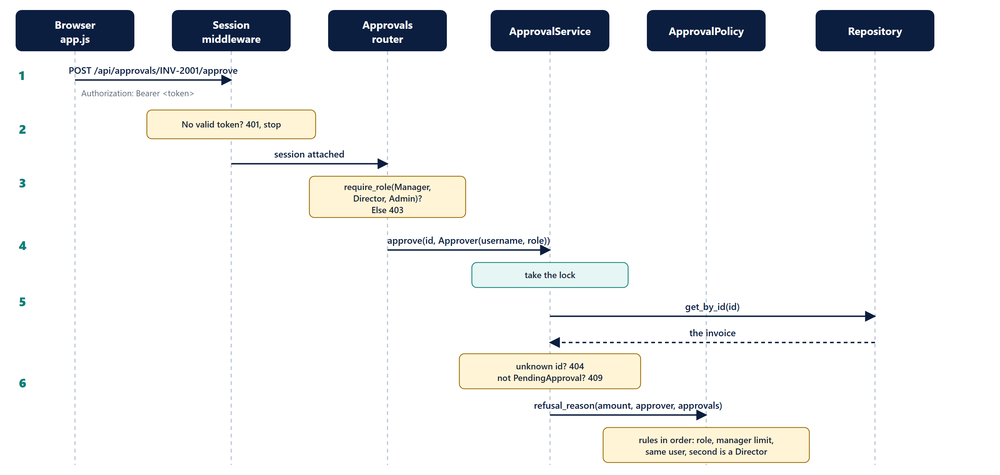
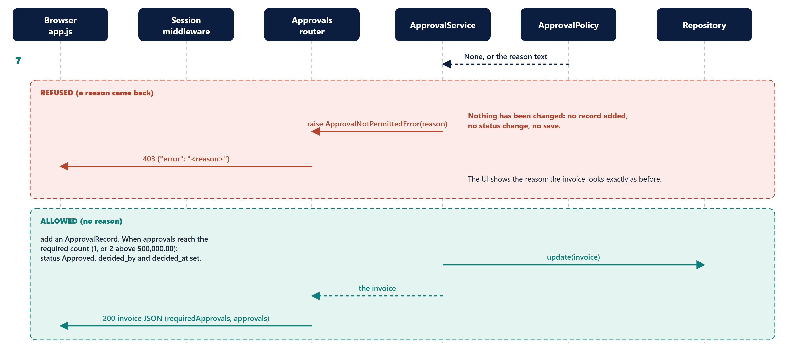
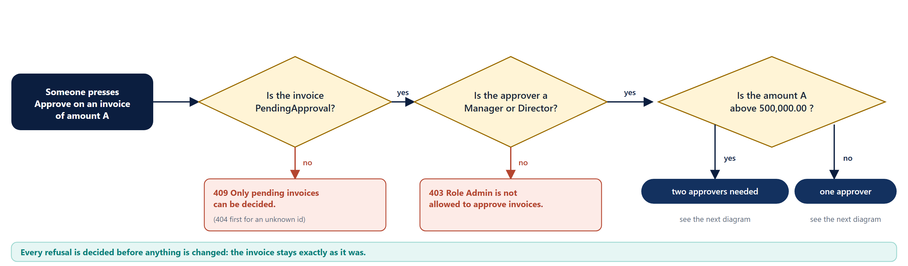
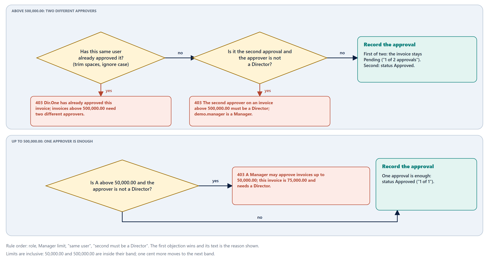
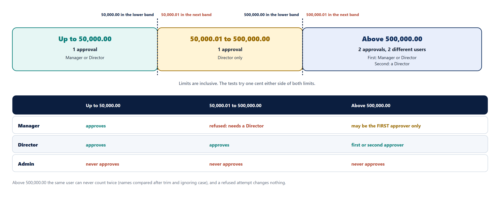
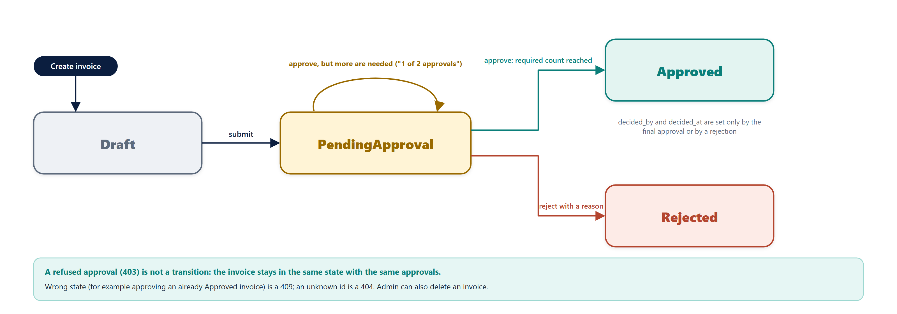
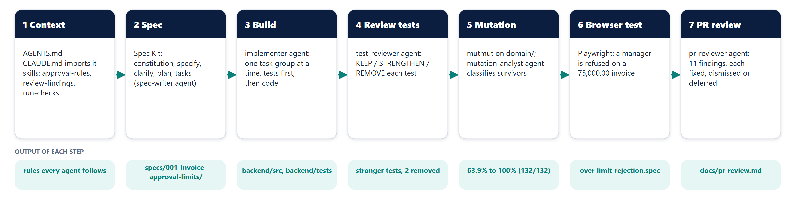
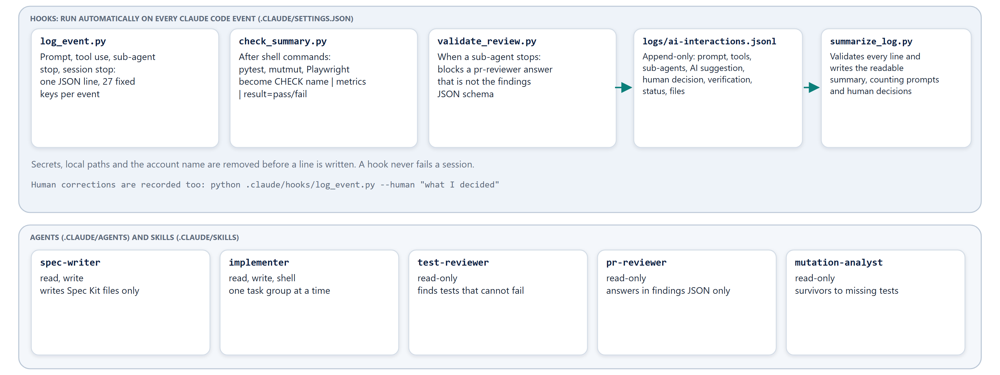
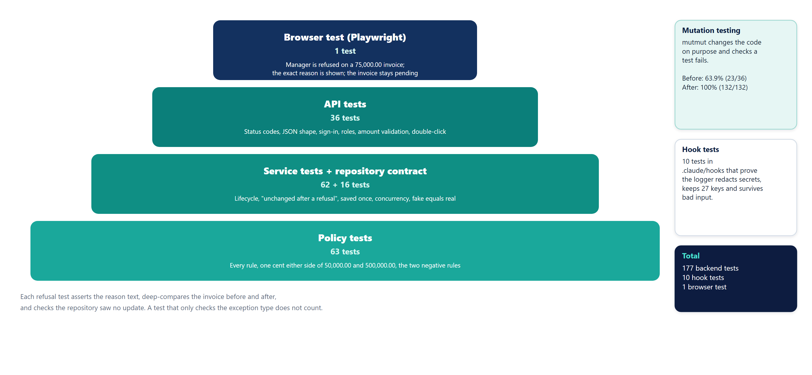

# Architecture Diagrams

Every diagram below is drawn from the real code: each box names a file or class that exists in this repository. The pictures are generated by `scripts/make_diagrams.py` (SVG and PNG in `docs/guides/img/diagrams/`), so they can be redrawn when the code changes.

How to read them: start with the big picture (section 1), follow one request through it (section 2), then read the rules (section 3) and the life of an invoice (section 4). Sections 5 to 7 cover how the work was done and checked.

## 1. System architecture



The application has three layers and one rule about how they depend on each other.

| Layer | Where | What it does | What it must not do |
| --- | --- | --- | --- |
| Browser | `backend/src/invoice_app/api/wwwroot/` | Plain HTML, JavaScript and CSS (no build step). Sends the session token as `Authorization: Bearer`. Shows the refusal reason, the rejection reason and "N of M approvals" | Decide anything about who may approve |
| Web layer | `backend/src/invoice_app/api/` | Sign-in check (401), role check on routes, translating HTTP to domain calls and domain errors to HTTP status codes, JSON shape | Hold business rules |
| Domain | `backend/src/invoice_app/domain/` | The approval rules, the invoice lifecycle, the storage contracts | Import anything from the web layer or from a storage implementation |
| Concrete parts | `api/in_memory_repository.py`, `api/auth/session_store.py`, `api/auth/user_directory.py` | The demo's storage, sessions and four demo accounts, chosen in `create_app` | Be imported by the domain |

**The dependency rule:** the web layer imports the domain, never the reverse. The concrete storage implements a contract (`ApprovalStore`, `InvoiceRepository`) that lives in the domain, so the domain depends on an interface it owns. That is why the unit tests and the mutation run need no web server and no database.

**The composition root:** `create_app(repository, users, policy)` in `api/main.py` is the one place that chooses concrete classes. Pass a different repository, user directory or policy and the whole app uses it. The tests do exactly this.

## 2. One approval request, end to end



1. The browser sends `POST /api/approvals/INV-2001/approve` with the session token.
2. The session middleware looks the token up. An unknown token is answered with **401** and nothing else runs.
3. The approvals router checks the role with `require_role("Manager", "Director", "Admin")`. A role outside that list gets **403**. (Admin passes this gate on purpose: the domain, not the router, decides who may actually approve, so the refusal text is the domain's.)
4. The router calls `ApprovalService.approve(id, Approver(username, role))`.
5. The service takes its lock and loads the invoice. An unknown id is **404**; an invoice that is not `PendingApproval` is **409**.
6. The service asks the policy `refusal_reason(amount, approver, approvals)`. The rules run in order and the first objection wins.



7. The policy answers with `None` or a reason.
   * **Refused:** the service raises `ApprovalNotPermittedError(reason)`; the router returns **403** `{"error": "<reason>"}`. Nothing was written: no record added, no status change, no save.
   * **Allowed:** the service adds an `ApprovalRecord`. When the number of approvals reaches the required count (1, or 2 above 500,000.00) it sets the status to Approved and `decided_by` / `decided_at`. It saves once and returns the invoice; the router answers **200** with `requiredApprovals` and the approvals list.

## 3. The approval rules as a decision flow

The rules are four small classes in `domain/approval_policy.py`, listed in `standard_policy()` in the order their reasons should be reported.





| Order | Rule class | Refuses when | Reason text (example) |
| --- | --- | --- | --- |
| 1 | `ApproverRoleRule` | the role is not Manager or Director (for example Admin) | `Role Admin is not allowed to approve invoices.` |
| 2 | `ManagerLimitRule` | 50,000.00 < amount <= 500,000.00 and the approver is not a Director | `A Manager may approve invoices up to 50,000.00; this invoice is 75,000.00 and needs a Director.` |
| 3 | `DistinctApproversRule` | amount > 500,000.00 and the same user (trimmed, case-insensitive) already approved | `demo.director has already approved this invoice; invoices above 500,000.00 need two different approvers.` |
| 4 | `SecondApproverMustBeDirectorRule` | amount > 500,000.00, a first approval exists and the approver is not a Director | `The second approver on an invoice above 500,000.00 must be a Director; demo.manager is a Manager.` |

The state check (is the invoice pending?) comes before the rules and belongs to the service, not the policy.

## 4. Who may approve what



Limits are inclusive. The tests try one cent either side of both limits: 50,000.00, 50,000.01, 500,000.00 and 500,000.01. Money is `Decimal`, never `float`.

## 5. The life of an invoice



A refused approval is not a transition. `decided_by` and `decided_at` are set only by the final approval or by a rejection. Admin can also delete an invoice.

## 6. How the AI tooling fits in





Each step leaves evidence in the repository: `AGENTS.md`, `specs/001-invoice-approval-limits/`, the code and tests, the reviewed tests, `docs/mutation/`, the browser test and `docs/pr-review.md`. The hooks run on every event and append one JSON line with 27 fixed keys to `logs/ai-interactions.jsonl`; `python scripts/summarize_log.py` validates the file and writes the readable summary. Details: guide 10, AI Workflow.

## 7. How it is tested



| Layer | Tests | Where | What it proves |
| --- | --- | --- | --- |
| Policy | 63 | `backend/tests/test_approval_policy.py` | Every rule, every boundary, the two negative rules |
| Service | 62 | `backend/tests/test_approval_service.py` | Lifecycle, "unchanged after a refusal", saved exactly once, concurrency |
| Repository contract | 16 | `backend/tests/test_repository_contract.py` | The fake and the real repository behave the same |
| API | 36 | `backend/tests/test_api.py` | Status codes, JSON shape, sign-in, roles, amount validation, double click |
| Browser | 1 | `e2e/tests/over-limit-rejection.spec.ts` | A Manager is refused on an over-limit invoice and sees why |
| Hooks | 10 | `.claude/hooks/test_log_event.py` | The logger redacts secrets and keeps its 27 keys |
| Mutation | 132 mutants | `docs/mutation/` | The domain unit tests notice every change (100%) |

## 8. Where to change what

| I want to... | Do this | Do not |
| --- | --- | --- |
| Add an approval rule | Write a new class with `refusal(attempt)` and add it to `standard_policy()`; add its tests | Edit an existing rule class or `ApprovalPolicy` |
| Change a limit | Pass different `ApprovalLimits` (they are data) | Hard-code a number in a rule |
| Use a database | Write a class that implements the contracts in `domain/repository.py`, pass it to `create_app`, make it pass `tests/test_repository_contract.py` | Import it from the domain |
| Add an endpoint | New route in the matching file in `api/routers/`, new tests in `test_api.py`; map any new domain error in `api/error_handling.py` | Put a rule in a router or in `main.py` |
| Change the UI | Edit `wwwroot/` and keep the roles and labels the browser test uses (`getByRole`, `getByLabel`) | Use CSS or XPath selectors in the test |

## 9. Redrawing the diagrams

```text
python scripts/make_diagrams.py
```

Writes the SVG and PNG files to `docs/guides/img/diagrams/`. Rebuild the PDFs afterwards with `python scripts/build_docs.py`.
