# UI Walkthrough

The running application, screen by screen. Every picture is a real screenshot of the app, cut down to the application itself (the browser frame and the taskbar are removed by `scripts/ui_screens.py`; the raw captures are not changed). Each screen says what you see and which rule it proves. The same walkthrough is available as slides in `docs/presentations/Invoice-Approval-UI-Walkthrough`.

To follow along: start the app with `python -m uvicorn invoice_app.api.main:app --app-dir backend/src --port 5000` and open `http://localhost:5000`. Start it fresh: `INV-2001` and `INV-2002` must still be pending.

## Accounts and roles

| Account | Role | Can approve | Also can |
| --- | --- | --- | --- |
| `demo.manager` | Manager | Invoices up to 50,000.00 | Create, submit, reject |
| `demo.director` | Director | Up to 500,000.00 alone; above that as first or second approver | Create, submit, reject |
| `demo.director2` | Director | The same as `demo.director`: a second, different person | Create, submit, reject |
| `demo.admin` | Admin | Nothing: Admin never approves | Create, submit, reject, delete |

Password for all four: `ChangeMe123!` (local demo only).

## 1. The sign-in screen

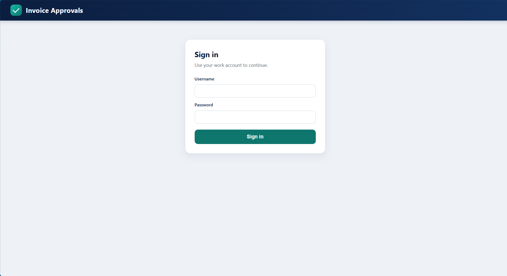

**What you see:** only a sign-in card. There is no Sign out button and no invoice data; every part of the app is behind sign-in (the server answers 401 to anything else).

**What it proves:** nothing is visible before sign-in, and the page does not pretend you are signed in.

## 2. A wrong password is refused

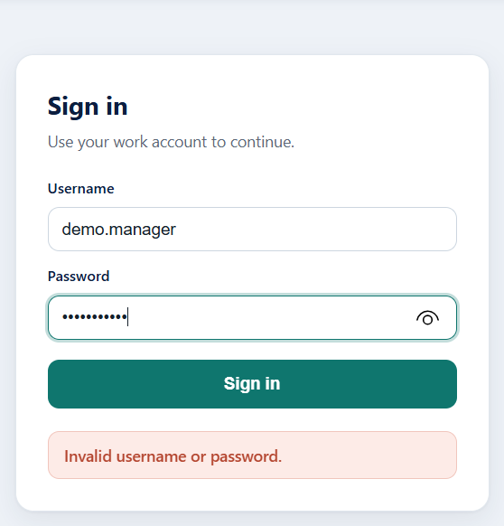

**What you see:** the message **Invalid username or password.** in a red notice under the button. It does not say which of the two was wrong, and the password is masked.

**What it proves:** sign-in failures are generic by design, so the form cannot be used to find out which usernames exist.

## 3. The Invoices tab

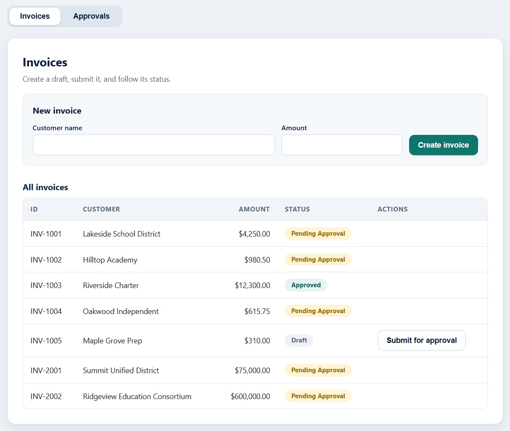

**What you see:** a **New invoice** form and the **All invoices** table. Status pills: Pending Approval (amber), Approved (teal), Draft (grey), Rejected (red). A Draft has a **Submit for approval** button. `INV-2001` (75,000.00) and `INV-2002` (600,000.00) are the invoices built to try the rules.

**What it proves:** the seed data covers every status, so each rule can be tried without creating anything first.

## 4. Rejecting needs a reason

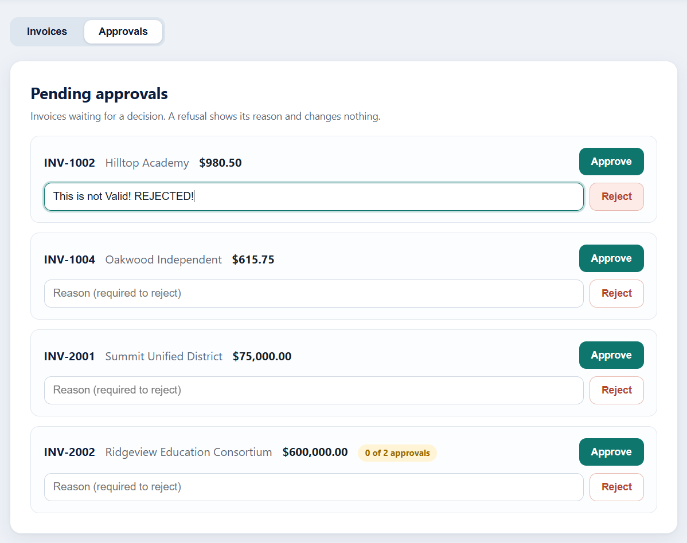

**What you see:** the **Approvals** tab lists every invoice waiting for a decision. Each card has **Approve**, a reason box and **Reject**. `INV-2002` shows **0 of 2 approvals**: it needs two people.

**What it proves:** Reject is a different action from a refused approval. It ends the invoice and requires a reason that is stored and shown later.

## 5. Reject without a reason is refused

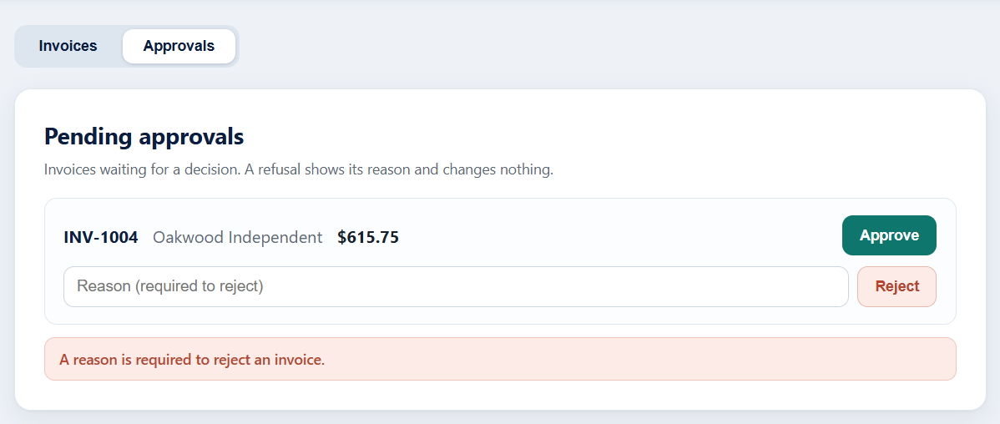

**What you see:** Reject was pressed with the reason box empty, and the notice says **A reason is required to reject an invoice.** The invoice is still in the list.

**What it proves:** a missing reason is bad input (HTTP 400), caught before the invoice is touched.

## 6. A Manager is refused above 50,000.00

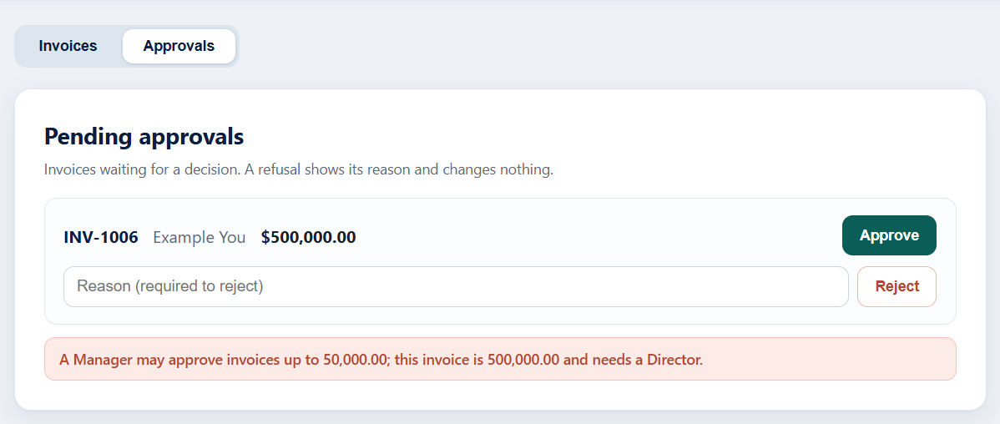

**What you see:** Approve was pressed on a 500,000.00 invoice while signed in as `demo.manager`. The reason is shown in full: **A Manager may approve invoices up to 50,000.00; this invoice is 500,000.00 and needs a Director.** The invoice is still waiting.

**What it proves:** the limit is enforced by role, the user is told exactly why, and a refusal changes nothing. This is the screen the browser test checks. (It also shows the boundary: 500,000.00 needs one Director, not two.)

## 7. A Director sees the larger invoices

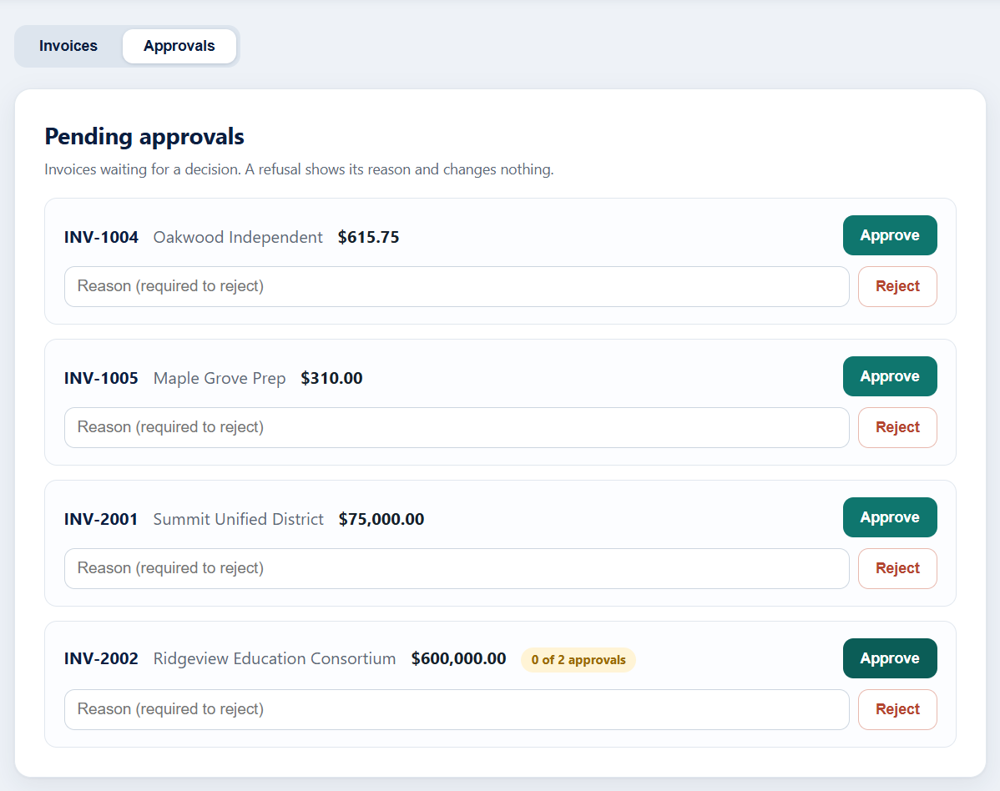

**What you see:** the same list signed in as `demo.director`. `INV-2001` can be approved here; `INV-2002` still reads **0 of 2 approvals**.

**What it proves:** between 50,000.01 and 500,000.00 one Director is enough. Above 500,000.00 the first approval only moves the counter.

## 8. The same Director cannot approve twice

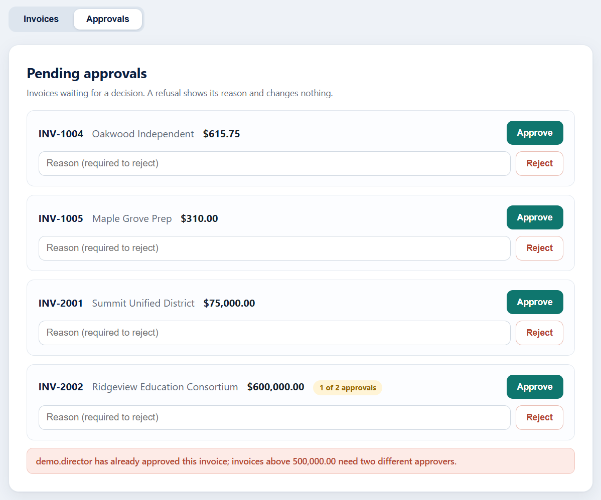

**What you see:** `INV-2002` now shows **1 of 2 approvals**. Approving again gives **demo.director has already approved this invoice; invoices above 500,000.00 need two different approvers.**

**What it proves:** the first negative rule. The same user never counts as both approvers, and the refused second attempt changes nothing.

## 9. A second, different Director takes over

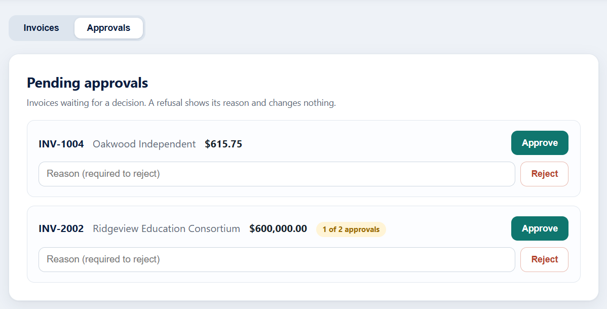

**What you see:** after signing out and in as `demo.director2`, `INV-2002` still reads **1 of 2 approvals**. The earlier message is gone: it is cleared on sign-out and on sign-in.

**What it proves:** the invoice waited in a valid state; the first approval was kept.

## 10. Two approvals complete the invoice

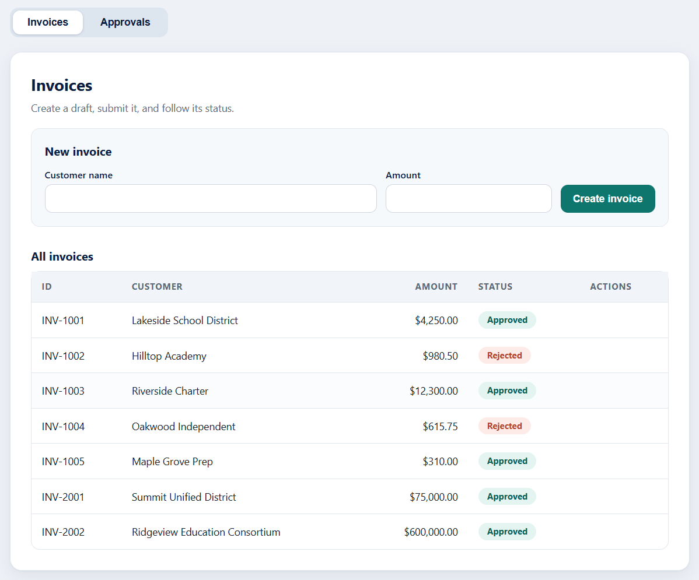

**What you see:** on the Invoices tab `INV-2002` is now **Approved**; rejected invoices carry a red pill.

**What it proves:** above 500,000.00 an invoice becomes Approved only when two different users, the second a Director, have approved.

## 11. Admin has nothing to approve

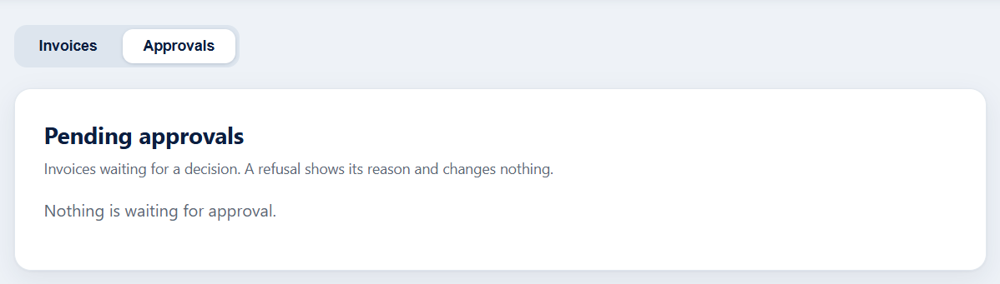

**What you see:** **Nothing is waiting for approval.** once every invoice has a decision.

**What it proves:** an empty queue is a normal state with its own message.

## 12. Admin may look, but not approve

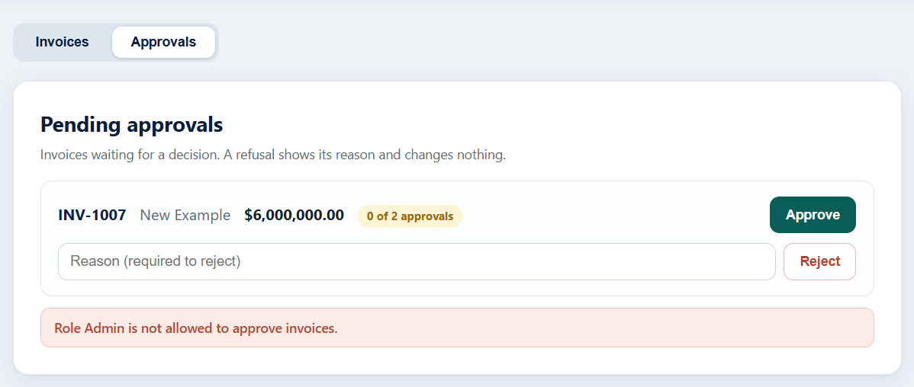

**What you see:** a 6,000,000.00 invoice waiting at **0 of 2 approvals**. Approve as Admin gives **Role Admin is not allowed to approve invoices.**

**What it proves:** Admin can reject and delete but never approve. The role check comes first, before any amount rule.

## 13. Creating a draft invoice

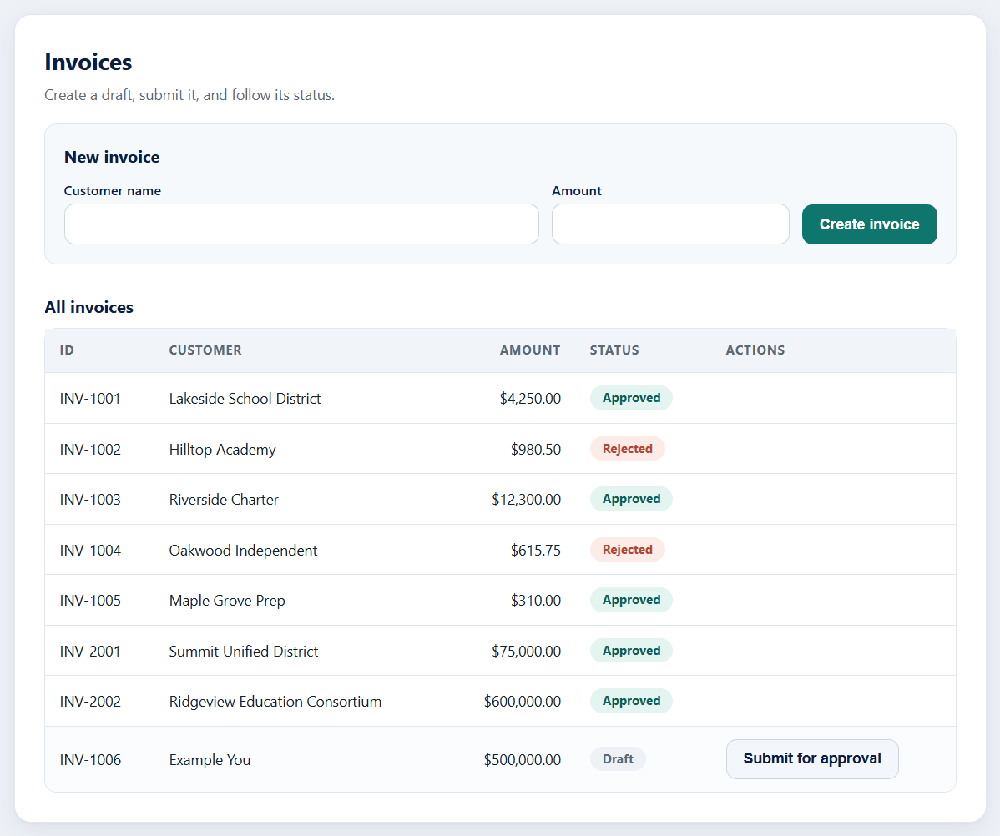

**What you see:** a new invoice appears as **Draft** with a **Submit for approval** button; it is not in anyone's queue yet. Amounts are checked on the server: zero, negative, sub-cent and huge values are rejected.

**What it proves:** an invoice moves Draft, then Pending, then Approved or Rejected. Amounts are exact decimals, never floating point.

## 14. Rejection reasons stay visible

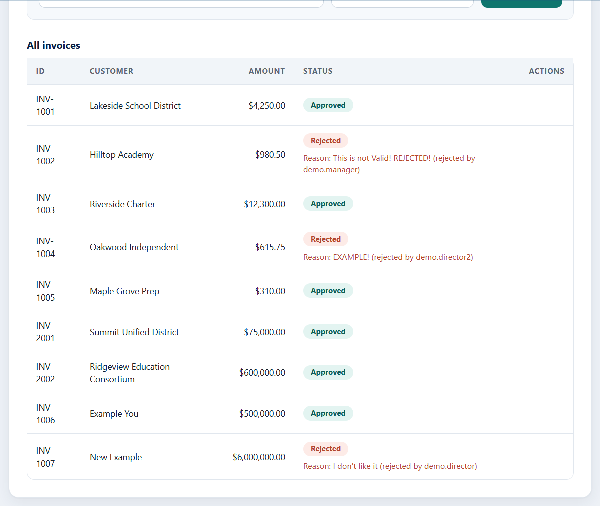

**What you see:** each Rejected invoice shows **Reason: ... (rejected by <name>)** under its pill.

**What it proves:** a rejection is accountable: the decider and the reason are stored with the invoice and shown to everyone.

## 15. Evidence from the terminal

Unit tests:

The two negative rules on their own (`python -m pytest backend/tests/test_approval_policy.py -v -k "same_user or second_approver"`):

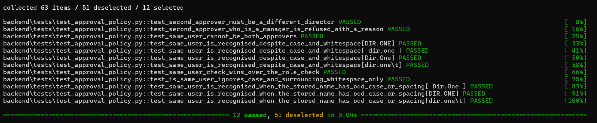

Mutation testing (`wsl -d Ubuntu-22.04 -- bash scripts/run_mutation.sh demo`): 132 of 132 mutants killed.

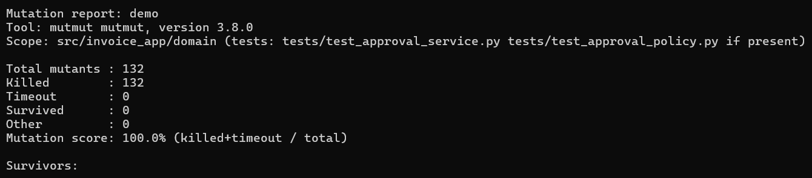

The browser test (`cd e2e; npx playwright test --headed; cd ..`):

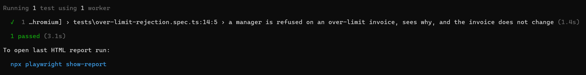

The terminal pictures show only the result lines; the prompt lines (which contain the folder path) are left out on purpose.

## Summary: every screen and the rule it proves

| Screen | Rule or behaviour proven |
| --- | --- |
| Sign-in and wrong password | Everything is behind sign-in; failures are generic |
| Reject with and without a reason | A reason is required, stored and shown with who rejected |
| Manager refused on 500,000.00 | Role limits are enforced with a clear reason; nothing changes |
| Same Director refused on INV-2002 | The same user never counts twice above 500,000.00 |
| Second Director completes INV-2002 | Two different approvers, the second a Director, are required |
| Admin refused | Admin can reject and delete but never approve |
| Draft and Submit | Invoices move Draft, Pending, then Approved or Rejected |
| Test, mutation and browser output | 177 tests, 100% mutation score and 1 browser test, all repeatable |
